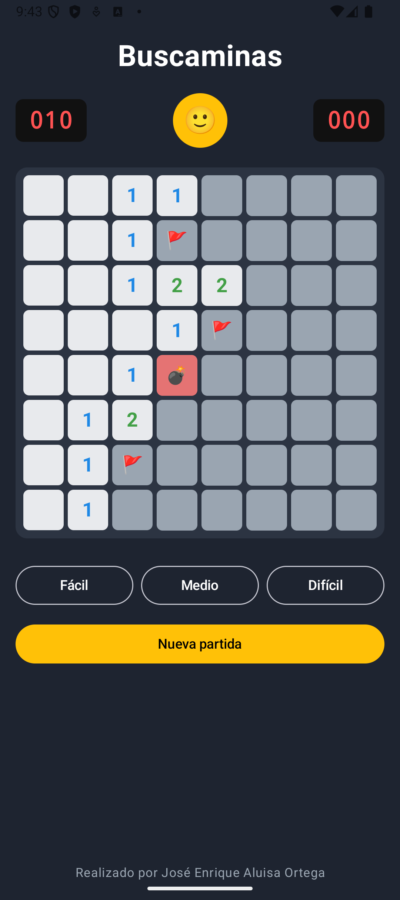

# Buscaminas (maqueta)

Maqueta del juego del Buscaminas para Android, sin funcionalidad. Proyecto de 2º de DAM (Desarrollo de Aplicaciones Multiplataforma).

## Tecnología

- Kotlin
- Jetpack Compose
- Android Studio

## Qué incluye

- Barra superior con contador de minas, carita y cronómetro
- Tablero de 8x8 con casillas ocultas, descubiertas, números, banderas y minas
- Botones de dificultad (Fácil, Medio, Difícil) y Nueva partida

## Captura

## Autor

José Enrique Aluisa Ortega